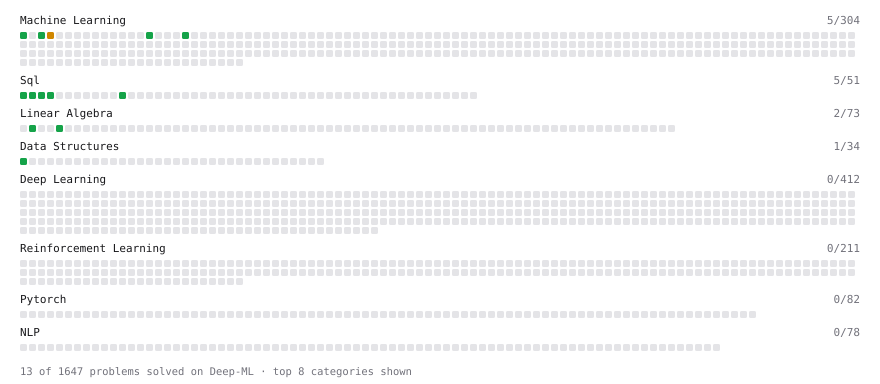

# Deep-ML

My machine learning practice from [Deep-ML](https://www.deep-ml.com). Every solution here was written by hand.

**17** solved · 17 problems · 0 labs · 0 math

[**Browse the interactive portfolio**](https://Ajeetkumar1850.github.io/deep-ml/) to replay this filling in over time.

## Problems

| | Difficulty | Solved | |
| --- | --- | --- | --- |
| [Calculate Accuracy Score](https://www.deep-ml.com/problems/36) | easy | 2026-10-25 | [solution](problems/0036-calculate-accuracy-score) |
| [Delete Duplicate Emails Keeping One](https://www.deep-ml.com/problems/1112) | easy | 2026-10-23 | [solution](problems/1112-delete-duplicate-emails-keeping-one) |
| [Feature Scaling Implementation](https://www.deep-ml.com/problems/16) | easy | 2026-10-22 | [solution](problems/0016-feature-scaling-implementation) |
| [Filter rows with WHERE](https://www.deep-ml.com/problems/1103) | easy | 2026-10-22 | [solution](problems/1103-filter-rows-with-where) |
| [Implement Precision Metric](https://www.deep-ml.com/problems/46) | easy | 2026-10-22 | [solution](problems/0046-implement-precision-metric) |
| [Linear Regression Using Normal Equation](https://www.deep-ml.com/problems/14) | easy | 2026-10-22 | [solution](problems/0014-linear-regression-using-normal-equation) |
| [Min-Max Scaling of Feature Values](https://www.deep-ml.com/problems/112) | easy | 2026-10-24 | [solution](problems/0112-min-max-scaling-of-feature-values) |
| [One-Hot Encoding of Nominal Values](https://www.deep-ml.com/problems/34) | easy | 2026-10-25 | [solution](problems/0034-one-hot-encoding-of-nominal-values) |
| [Reverse a Singly Linked List](https://www.deep-ml.com/problems/1250) | easy | 2026-10-26 | [solution](problems/1250-reverse-a-singly-linked-list) |
| [Scalar Multiplication of a Matrix](https://www.deep-ml.com/problems/5) | easy | 2026-10-24 | [solution](problems/0005-scalar-multiplication-of-a-matrix) |
| [SELECT all rows](https://www.deep-ml.com/problems/1101) | easy | 2026-10-22 | [solution](problems/1101-select-all-rows) |
| [Select specific columns](https://www.deep-ml.com/problems/1102) | easy | 2026-10-22 | [solution](problems/1102-select-specific-columns) |
| [Sort results with ORDER BY](https://www.deep-ml.com/problems/1104) | easy | 2026-10-22 | [solution](problems/1104-sort-results-with-order-by) |
| [Transpose of a Matrix](https://www.deep-ml.com/problems/2) | easy | 2026-10-22 | [solution](problems/0002-transpose-of-a-matrix) |
| [GPU Credit Ledger with Expiration](https://www.deep-ml.com/problems/1152) | medium | 2026-10-26 | [solution](problems/1152-gpu-credit-ledger-with-expiration) |
| [K-Means Clustering](https://www.deep-ml.com/problems/17) | medium | 2026-10-23 | [solution](problems/0017-k-means-clustering) |
| [Queue from Two Stacks and a Min-Stack](https://www.deep-ml.com/problems/1147) | medium | 2026-10-27 | [solution](problems/1147-queue-from-two-stacks-and-a-min-stack) |

---

_This file is regenerated by Deep-ML on every push._
